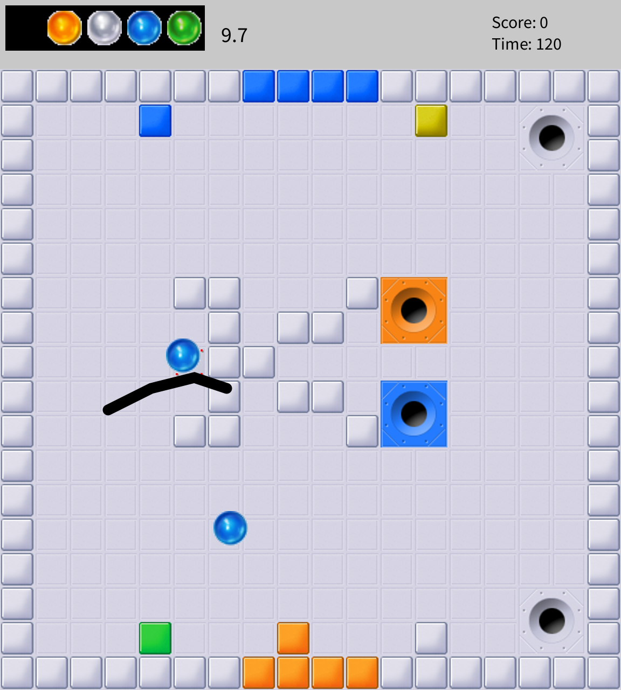
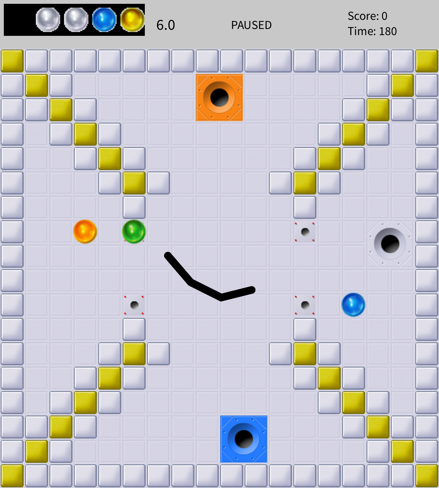
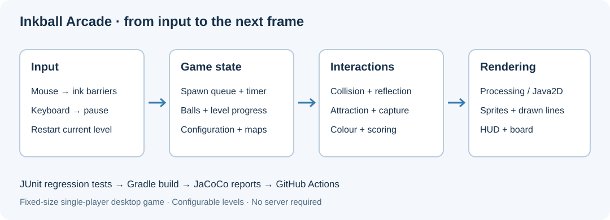

# Inkball Arcade

[](https://github.com/MakenzieAhern/inkball-arcade/actions/workflows/ci.yml)


**Draw a path. Redirect the bounce. Match the colours.**

Inkball Arcade is a Java desktop puzzle game built with Processing. Draw temporary barriers to guide moving balls into matching holes before time runs out. Colour-changing walls, destructible bricks, and a timed spawn queue create three increasingly busy levels.

The project demonstrates object-oriented game modelling, vector-based collision response, event-driven input, configurable level loading, and automated regression testing. This portfolio edition also corrects gameplay defects and packages the default levels so the game can run outside its source directory.



## Play locally

Use a **JDK 17** and a desktop display. The included **Gradle 8.8** wrapper downloads the required dependencies on first use.

```bash
git clone https://github.com/MakenzieAhern/inkball-arcade.git
cd inkball-arcade
./gradlew run
```

On Windows, use `gradlew.bat run`. No IDE, database, or separate Processing installation is required.

| Input | Action |
| --- | --- |
| Left mouse drag | Draw a barrier; release to place it. |
| Right click, or Ctrl + left click | Remove a nearby barrier. |
| Space | Pause or resume. |
| R | Restart the current level; after finishing the campaign, start again. |

A ball consumes the barrier it hits. Clear every queued and initially placed ball to advance. Watch the top bar for the spawn queue, time remaining, and score.

## Game mechanics

- **Five ball colours:** grey, orange, blue, green, and yellow. Match ball and hole colours; grey balls and grey holes act as wildcards.
- **Vector reflection:** balls bounce off window edges, walls, bricks, and player-drawn line segments.
- **Colour-changing walls:** coloured wall tiles change a ball's colour on contact, allowing you to redirect it toward a different goal.
- **Destructible bricks:** a brick takes three matching-colour hits to break. Grey bricks accept any colour.
- **Hole attraction:** nearby balls are drawn toward a hole and shrink as they approach its centre.
- **Wrong-hole penalties:** an incorrect capture subtracts points and returns the ball to the queue.
- **Three levels:** layouts, timers, spawn intervals, ball queues, bricks, and scoring multipliers are configuration-driven.

The game runs at a target of 30 frames per second in a 576 × 640 window. The board uses 32-pixel tiles below a 64-pixel status bar.



## Build, test, and package

```bash
./gradlew clean build
```

Tests must pass for the build to succeed. JUnit verifies gameplay state, collisions, scoring, resource loading, and restart behavior. JaCoCo reports measured coverage:

- Test report: `build/reports/tests/test/index.html`
- Coverage report: `build/reports/jacoco/test/html/index.html`
- Runnable JAR: `build/libs/inkball-arcade-1.0.0.jar`
- Application distribution: `build/distributions/inkball-arcade-1.0.0.zip`

```bash
java -jar build/libs/inkball-arcade-1.0.0.jar
```

The JAR includes the default configuration, layouts, sprites, and Processing dependency. It still requires Java 17 and a graphical desktop. The ZIP includes launch scripts for a distribution-style installation.

[Verification notes](docs/VERIFICATION.md) record the actual test results and the failures found in the original baseline. GitHub Actions repeats the build and rendering check on Ubuntu / Java 17, with reports available as workflow artifacts.

To include the real-window rendering check and regenerate the two screenshots on a graphical desktop:

```bash
./gradlew clean build -PcaptureScreenshots
```

The default build runs 65 unit tests and skips the optional rendering check; the command above runs all 66 tests.

## Architecture



| Component | Responsibility |
| --- | --- |
| `App` | Processing lifecycle, input, rendering, timers, level state, spawning, and collision orchestration. |
| `Ball` | Position/velocity, vector reflection, colour changes, attraction, and capture scoring. |
| `Hole` | Capture target geometry and colour. |
| `Brick` | Three-hit durability and colour matching. |
| `Line` | Player-drawn barrier points and rendering. |
| `GameResources` | Bundled resources and explicit external configuration loading. |

```text
config.json                 Level order, timers, queues, bricks, and scores
level1.txt ... level3.txt    Editable tile maps
src/main/java/inkball/      Game implementation
src/main/resources/inkball/ Sprite assets
src/test/java/inkball/      Unit and rendering checks
docs/                      Screenshots, verification, and provenance
```

## Design your own level

The root configuration and layout files are the source for bundled defaults; rebuilding incorporates changes. For a separate configuration without rebuilding, copy `config.json` and the referenced layout files into a folder, edit them, and run:

```bash
./gradlew -Dinkball.config=/absolute/path/to/my-game/config.json run
```

For a packaged JAR:

```bash
java -Dinkball.config=/absolute/path/to/my-game/config.json -jar inkball-arcade-1.0.0.jar
```

External layout paths resolve relative to the supplied configuration file. A missing explicit configuration is reported instead of silently loading the defaults.

| Layout token | Meaning |
| --- | --- |
| Space | Empty floor |
| `X` | Neutral wall |
| `1`–`4` | Orange, blue, green, or yellow wall |
| `S` | Ball spawn point |
| `H0`–`H4` | Hole colour (0 is grey) |
| `B0`–`B4` | Initially placed ball |
| `b0`–`b4` | Destructible brick |

Colour markers after `H`, `B`, and `b` are part of a two-character token. Preserve map spacing. The bundled board is 18 × 18 tiles; custom maps should fit that fixed viewport. Holes occupy a 64 × 64 area, so leave room around them.

Capture points and wrong-hole penalties are keyed by colour in `config.json`, then multiplied by the current level's modifiers and converted to integer scores. The default capture values are 70/50/50/50/100 for grey/orange/blue/green/yellow; penalties are 0/25/25/25/100.

## Improvements in the portfolio edition

- Removed the original `ignoreFailures = true` setting so failed tests fail the build.
- Repaired test fixtures and assertions that did not exercise the actual game state; removed an empty sample test and a test-only duplicate of collision code.
- Corrected timing, restart and level-transition behavior, and ball visibility while paused.
- Stabilised hole-attraction scaling and made capture scoring idempotent.
- Made brick destruction state consistent with remaining hits.
- Updated Processing to 4.5.7 for Java 17 compatibility on modern macOS.
- Bundled game resources for portable launch, removed an unused dependency, and added CI and verification documentation.

## Scope and provenance

This is a local single-player arcade project. Ball movement uses pixels per rendered frame at a target of 30 FPS. Collision detection uses discrete steps, so extreme custom velocities can miss thin obstacles. There is no network multiplayer, saved campaign, leaderboard, or general-purpose physics engine.

The original game code was independently developed by **Yuchen Deng**, who also maintains this portfolio edition. It began as a coursework project; [provenance notes](docs/PROVENANCE.md) distinguish inherited code/assets from the migration and fixes. The supplied files did not include an asset attribution manifest or a project license, so this repository does not claim a blanket open-source license over the bundled artwork.
